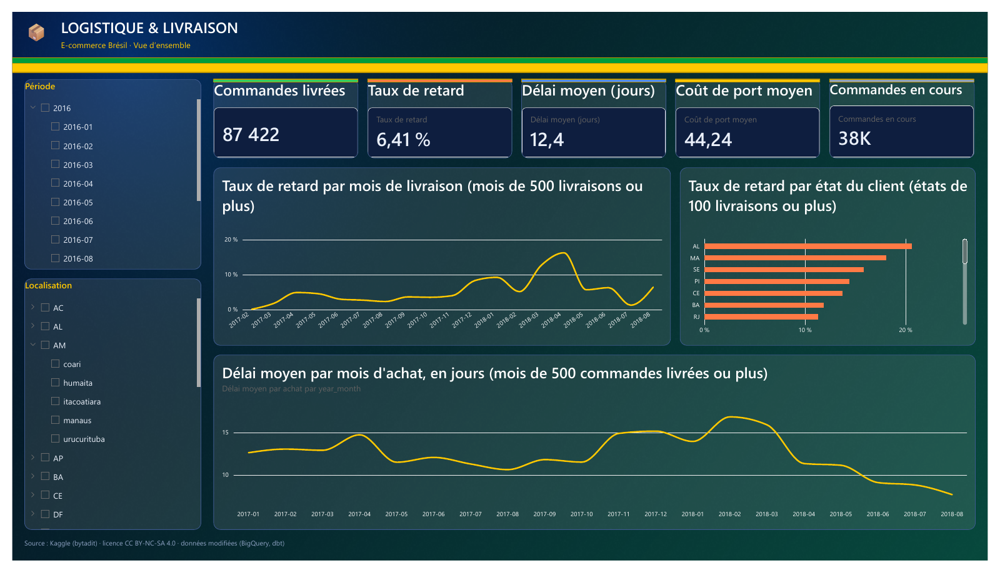
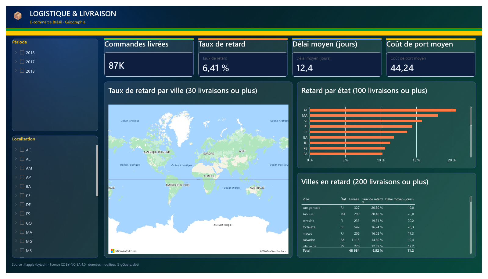
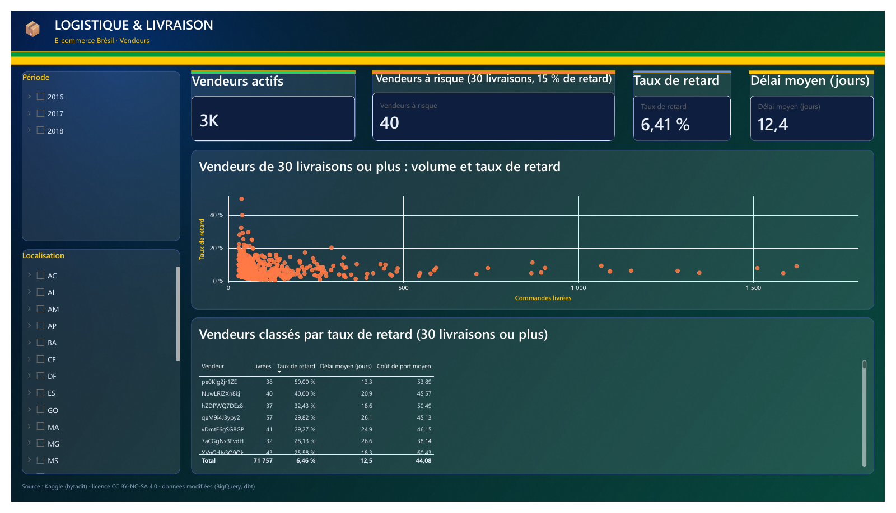
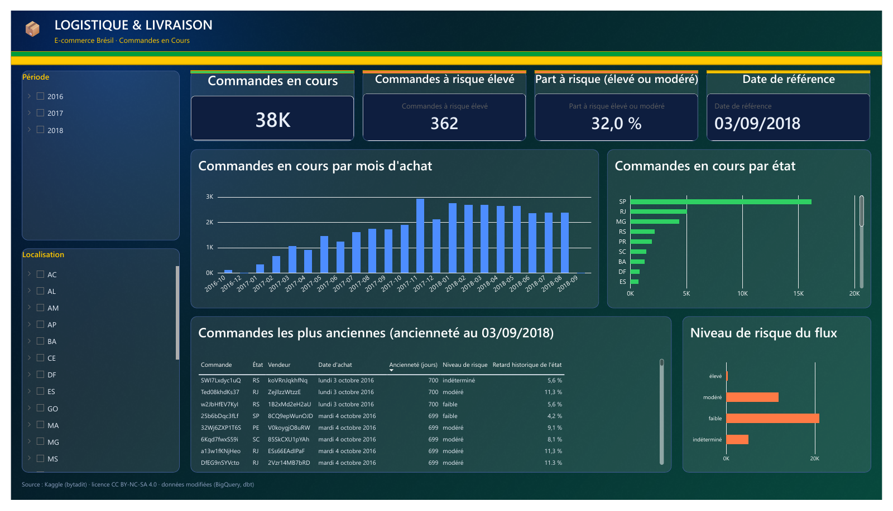
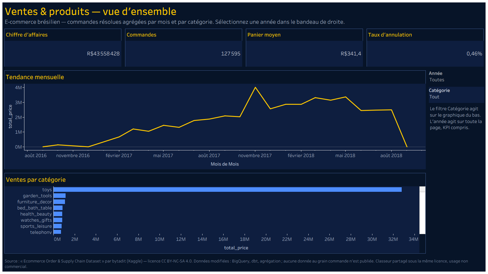
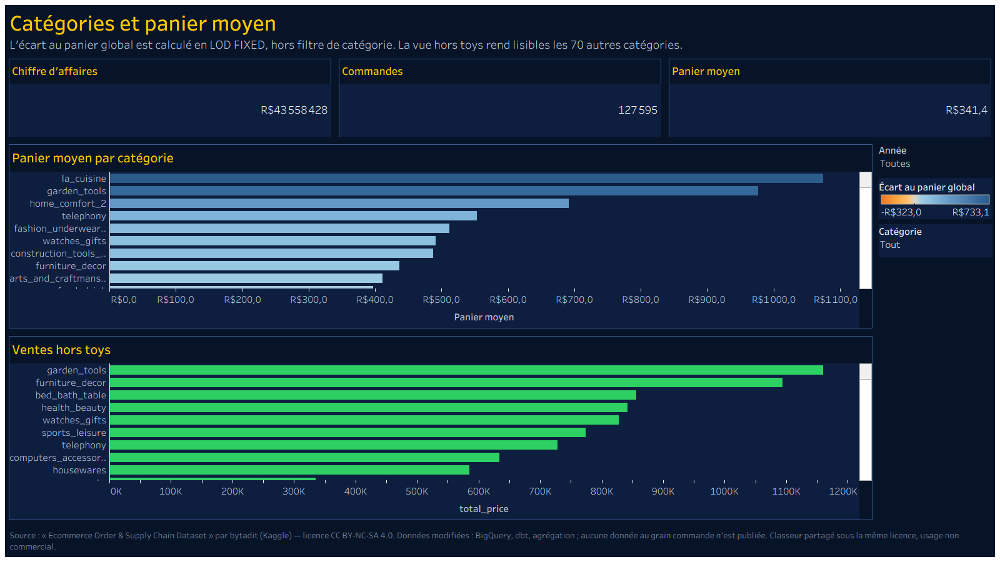
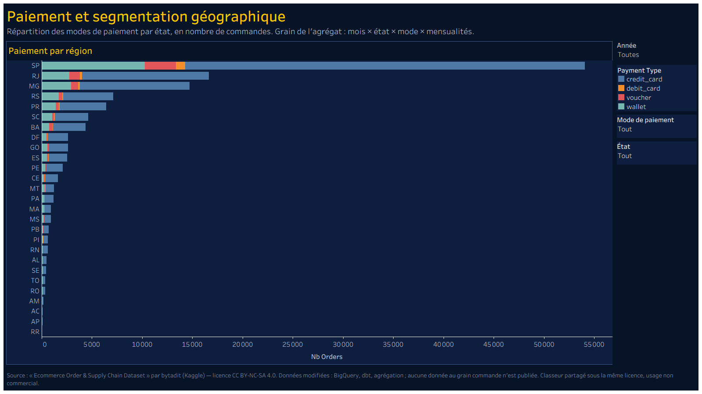
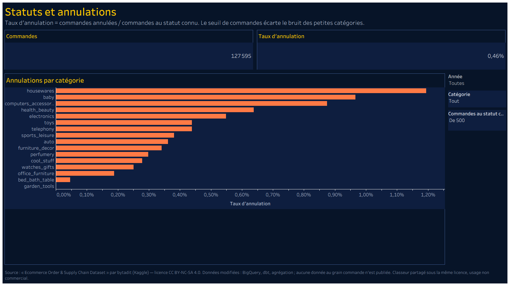

# Pipeline data e-commerce brésilien — GCP · dbt · Airflow

> Projet de portfolio terminé. Le pipeline va de l'ingestion aux dashboards, et les huit pages de restitution sont reproduites plus bas.

Pipeline de données complet construit autour d'un dataset e-commerce brésilien livré en 5 tables relationnelles, avec un split train/test détourné en **flux d'ingestion réaliste** : le train sert de backfill historique, le test simule des commandes en cours, sans issue connue.

## Stack

| Étape | Outil |
|---|---|
| Stockage fichiers | Google Cloud Storage |
| Entrepôt | BigQuery |
| Transformation | dbt Core |
| Orchestration | Airflow (local, Docker Compose) |
| Restitution | Power BI (logistique) · Tableau (ventes) |

Contrainte : rester intégralement dans le niveau gratuit GCP.

## Le parti pris du projet

Le test set ne contient ni `order_status`, ni date de livraison réelle, ni date de livraison estimée — exactement les colonnes qu'on ignore tant qu'une commande n'est pas résolue. Plutôt que de l'écarter, il est injecté par batches comme un flux entrant. Ces commandes traversent donc le pipeline **sans statut ni date de livraison inventés**, et sont isolées des KPI historiques (un délai moyen calculé sur des commandes non livrées serait faux).

## Pourquoi ce dataset

Une première version de ce projet s'appuyait sur **DataCo Smart Supply Chain**, livré en un seul CSV plat. Deux limites l'ont fait abandonner : un fichier unique ne laisse rien à modéliser — pas de jointure, pas de schéma en étoile à construire, donc pas de travail de transformation représentatif — et il n'offre aucun moyen crédible de simuler un flux d'ingestion.

Le dataset brésilien lève les deux : **5 tables relationnelles** à assembler, et un **split train/test** dont les colonnes absentes côté test se prêtent exactement à la simulation de commandes en cours.

## Avancement

- [x] 00 · Cadrage & datasets
- [x] 01 · Socle GCP
- [x] 02 · Ingestion initiale (backfill train)
- [x] 03 · Ingestion incrémentale (flux test simulé)
- [x] 04 · dbt — staging
- [x] 05 · dbt — marts
- [x] 06 · Tests & qualité
- [x] 07 · Orchestration Airflow
- [x] 08 · Dashboard Power BI — Logistique & Livraison
- [x] 09 · Dashboard Tableau — Ventes & Produits *(publication en ligne impossible : voir ci-dessous)*
- [x] 10 · Documentation & portfolio

Feuille de route détaillée : [`docs/feuille-de-route.html`](docs/feuille-de-route.html) (à ouvrir dans un navigateur).

## Ingestion incrémentale

Scénario : le rattrapage d'un système source non encore migré. Le jeu test est découpé en 24 lots mensuels (`scripts/decouper_lots_test.py`) stockés dans une zone `source/` du bucket, hors du pipeline. Chaque run du DAG quotidien livre un mois : il copie le lot de `source/test/<table>/mois=AAAA-MM/` vers `raw/<table>/load_type=incremental/load_date=<date du run>/`, puis lance `dbt run` et `dbt test`.

Les tables `raw` sont des tables externes BigQuery sur ces dossiers : déposer un fichier suffit, et rejouer un run réécrit le même fichier, sans doublon. Détail des choix : [`docs/decisions.md`](docs/decisions.md). DDL : `sql/raw/`, contrôles : `sql/controles/`.

## Orchestration (Airflow local)

Le DAG `ecommerce_br_incremental` (`airflow/dags/`) livre un lot mensuel par run quotidien : copie des 5 tables de `source/` vers `raw/`, puis `dbt run`, `dbt test` et une notification. Il tourne dans Docker Compose (LocalExecutor + PostgreSQL), avec dbt installé dans un environnement virtuel de l'image aux versions de `requirements.txt`.

Pour le lancer (Docker Desktop requis) :

1. Créer `airflow/.env` à partir de `airflow/.env.example`.
2. Placer la clé d'un compte de service dans `airflow/secrets/gcp-key.json` (dossier ignoré par git, jamais commité).
3. Depuis `airflow/` : `docker compose up -d`, puis ouvrir http://localhost:8080 et activer le DAG (il est créé en pause).

Avec `catchup=True`, les 24 runs (du 2 au 25 octobre 2026, un lot chacun) s'enchaînent d'un coup. Le mois livré se calcule depuis la date du run : un retry redonne le même lot, sans doublon. Détails : [`docs/decisions.md`](docs/decisions.md).

## Modélisation

```
dbt/models/
├── staging/                        1 modèle par table source, aucune jointure
├── intermediate/                   taux de retard historiques, par vendeur et par état
└── marts/
    ├── shared/                     dim_date · dim_client · dim_produit
    ├── logistique/   → Power BI    fact_expeditions · fact_commandes_en_cours
    └── ventes/       → Tableau     fact_commandes · fact_ventes_categorie · fact_ventes_paiement
```

Les dimensions partagées ne sont jamais dupliquées : les deux marts les référencent via `ref()`. Les commandes résolues et les commandes en cours vivent dans deux faits séparés, pour qu'aucun calcul de délai ne puisse mélanger les deux — une moyenne de délai incluant des commandes non livrées serait fausse sans rien signaler.

## Tests & qualité

**89 tests dbt : 86 réussis, 3 avertissements attendus, 0 échec.**

Les tests génériques (`unique`, `not_null`, `accepted_values`, `relationships`) sont déclarés dans les fichiers `_*.yml` ; les règles métier sont des tests singuliers dans `dbt/tests/` — un délai de livraison jamais négatif, une commande jamais présente dans les deux faits à la fois, un flux incrémental sans statut, un taux toujours dans `[0, 1]`.

La répartition des sévérités est délibérée. Les anomalies **connues de la source** sont en `severity: warn` (6 commandes `delivered` sans date de livraison, 4 poids à 0, 3 paiements à 0 mensualité) ; les violations de **règles métier** sont en `error`. Un test qui échoue signale donc un bug ou une régression, jamais un défaut déjà inventorié.

## Restitution

**Power BI — Logistique & Livraison** (DAX). Quatre pages : vue d'ensemble, géographie avec carte du Brésil au niveau ville, performance par vendeur, et commandes en cours. Cette dernière classe le flux entrant par **niveau de risque**, déduit des taux de retard déjà mesurés sur l'historique — vendeur et état — plutôt que d'un pronostic : `élevé` quand les deux signaux se cumulent, `indéterminé` quand aucun n'est exploitable. Rien n'est inventé sur une commande dont on ignore l'issue.

**Tableau — Ventes & Produits** (LOD, pas de DAX). Quatre pages : tendance mensuelle, catégories et panier moyen, paiement par région, annulations. Chacune porte une rangée de cartes KPI et une colonne de filtres — année, catégorie, mode de paiement, état. Les expressions LOD ne sont employées que là où un agrégat simple ne suffit pas : la part d'une catégorie dans le total, et l'écart au panier moyen général. Le filtre de catégorie est volontairement laissé hors contexte, faute de quoi le `FIXED` du panier global serait recalculé sur la sélection et l'écart tomberait à zéro.

Les deux outils partagent la **même charte** (`Dashboards/Power BI/theme/ecommerce-brasil.json`) : la différence porte sur le domaine métier et le langage de calcul, pas sur l'habillage.

Le classeur Tableau n'est **pas publié en ligne** : l'édition gratuite de Tableau Desktop désactive les entrées « Enregistrer dans Tableau Public » du menu Serveur. Le `.twb` étant portable, il s'ouvre dans Tableau Public Desktop pour qui veut le rejouer. Les captures ci-dessous en tiennent lieu — ce qui reste cohérent avec la licence du jeu de données, qui interdit de redistribuer les données.

Les deux outils ne lisent pas la même chose. Power BI se connecte directement à BigQuery ; Tableau consomme deux agrégats exportés en CSV par `scripts/export_tableau.py`, qui ne portent que des **mesures additives** — compteurs et sommes, jamais de moyenne pré-calculée — afin que les LOD recalculent correctement en `SUM / SUM`.

### Les quatre pages Power BI

| | |
|---|---|
|  |  |
| **Vue d'ensemble** — taux de retard, délai et coût de port moyens | **Géographie** — retard par état et par ville |
|  |  |
| **Vendeurs** — volume contre taux de retard, à partir de 30 livraisons | **Commandes en cours** — le flux entrant classé par niveau de risque |

### Les quatre pages Tableau

Chaque page porte l'attribution CC BY-NC-SA en pied, comme l'impose la clause de partage dans les mêmes conditions.

| | |
|---|---|
|  |  |
| **Vue d'ensemble** — KPI, tendance mensuelle, ventes par catégorie | **Catégories et produits** — panier moyen et écart au panier global, vue hors `toys` |
|  |  |
| **Paiement et segmentation** — modes de paiement par état | **Statuts et annulations** — taux par catégorie, au-dessus du seuil de volume |

## Ce que montrent les données

- **127 595 commandes** : 89 316 de backfill historique, 38 279 de flux entrant sans issue connue.
- **43,6 M** de chiffre d'affaires, panier moyen de **341**.
- **6,4 %** des livraisons arrivent après la date estimée ; délai médian de 10 jours.
- La catégorie `toys` pèse **75 % des commandes**. Le déséquilibre porte sur le volume et non sur le panier (342 contre 341 en moyenne), d'où une vue dédiée qui l'exclut pour rendre les 70 autres catégories lisibles.

## Structure du dépôt

```
dbt/            modèles, tests et macro de routage des schémas
airflow/        Dockerfile, docker-compose et le DAG incrémental
scripts/        découpage du jeu test en lots · export des agrégats Tableau
sql/            DDL des tables externes et requêtes de contrôle
Dashboards/     projet Power BI (PBIP) et classeur Tableau (.twb)
docs/           décisions de conception, attribution, feuille de route
```

## Données

**Source :** [« Ecommerce Order & Supply Chain Dataset »](https://www.kaggle.com/datasets/bytadit/ecommerce-order-dataset/data), par `bytadit` sur Kaggle, sous licence [CC BY-NC-SA 4.0](https://creativecommons.org/licenses/by-nc-sa/4.0/). Les données ont été modifiées : rechargées dans BigQuery, nettoyées et modélisées avec dbt. Ce dépôt n'en redistribue aucune.

Les CSV sources **ne sont pas versionnés** dans ce dépôt (voir `.gitignore`), pas plus que les fichiers Power BI `.pbix` qui en contiennent une copie. Structure attendue en local :

```
Ecommerce Order Dataset/
├── train/   df_Orders.csv · df_OrderItems.csv · df_Customers.csv · df_Products.csv · df_Payments.csv
└── test/    (mêmes fichiers ; df_Orders.csv n'a que 4 colonnes)
```
